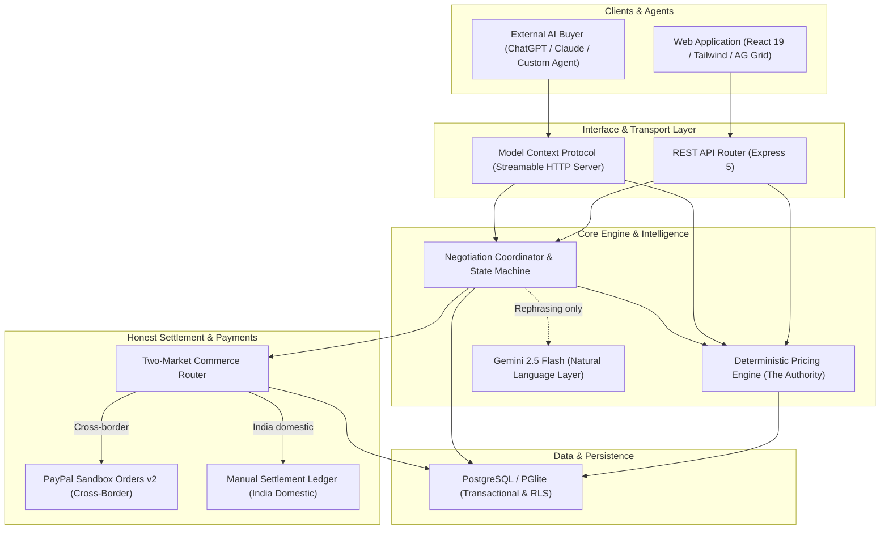
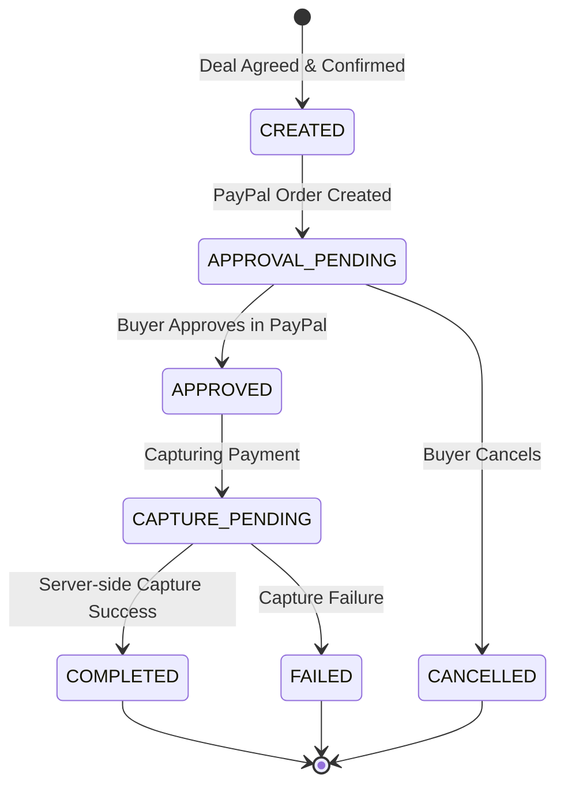
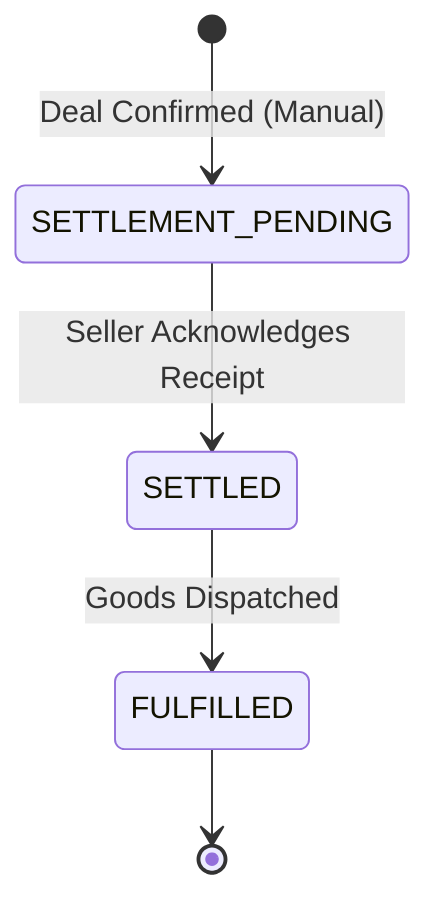

# BhavAI Architecture & Systems Design

> Agent-Ready Commerce Platform | PayPal AI Hackathon 2026

BhavAI transforms conventional digital storefronts into discoverable, negotiable, and transactable digital storefronts for autonomous AI buyers and agents, while enforcing server-side deterministic control for sellers.

---

## 1. System Overview

---

## 2. Core Architectural Principles

### 2.1 The Principle of Deterministic Authority
The language model (LLM) **never** decides whether a financial transaction or negotiation offer is valid.
1. The seller configures confidential policies: floor price, maximum discount percentage, bulk discount tiers, minimum order quantity, and maximum rounds.
2. The deterministic backend evaluates every buyer offer and calculates counteroffers.
3. If Google Gemini is configured, it rephrases the deterministic response into natural conversational language without altering the numerical price, quantity, or outcome.
4. If Gemini is unavailable or unconfigured, the platform seamlessly falls back to pre-validated deterministic policy explanations.

### 2.2 Confidentiality of Commercial Policy
Floor prices, internal profit margins, and maximum discounts are strictly confined to the seller's private domain.
- Public Storefront API endpoints: Expose listed prices, stock, bulk discount thresholds, and public terms only.
- Buyer MCP Connection: Exposes product discovery, offer submission, and deal status tools. Never reveals seller floor prices.

### 2.3 Two-Market Commerce Routing
Indian PayPal accounts cannot receive domestic payments from Indian buyers under standard domestic regulations. BhavAI solves this by identifying market geometry:
- **India Domestic (IN → IN):** Settle off-platform via invoice/UPI/bank transfer. Order is marked `SETTLEMENT_PENDING` and transitioned to `SETTLED` once the seller acknowledges receipt. Never marked as PayPal-paid.
- **Cross-Border (IN → Global / US):** Powered by the PayPal Orders API v2 in Sandbox mode. Captures payment server-side and reconciles against the agreed deal amount.

---

## 3. Database Schema

BhavAI runs on PostgreSQL (managed via Supabase or embedded via ElectricSQL PGlite):

| Table | Purpose |
|---|---|
| `users` | User accounts, credentials, and roles (`SELLER`, `BUYER`, `ADMIN`). |
| `sellers` | Seller profile, business name, country, currency, and store slug. |
| `buyers` | Buyer profile, country, currency, company name, preferences. |
| `products` | Product listings, SKUs, listed prices, stock levels, categories, images. |
| `seller_rules` | Confidential negotiation rules: floor price, max discount %, bulk tiers, max rounds. |
| `negotiations` | Live and archived negotiations between buyers and sellers for specific products. |
| `offers` | Turn-by-turn offer history, validation codes, and agent reasoning. |
| `deals` | Final agreed deals locked with agreed unit price, quantity, and total amount. |
| `orders` | Commercial order records with payment provider (`PAYPAL` vs `MANUAL`) and status. |
| `payments` | PayPal transaction captures or manual settlement logs. |
| `webhook_events` | Idempotent log of processed PayPal webhook event IDs. |
| `audit_logs` | Traceability of administrative and commercial actions. |

---

## 4. Payment State Machine

For India domestic orders:

---

## 5. Model Context Protocol (MCP) Integration

BhavAI implements an official Model Context Protocol (MCP) server running on the **Streamable HTTP** transport.
- Endpoint: `POST /mcp`
- Authentication: Bearer token format `bvk_<token>` generated in the Seller Studio or Buyer Workspace.
- Multi-tenant Isolation: MCP servers are instantiated per request, bound strictly to the caller's authenticated account.

